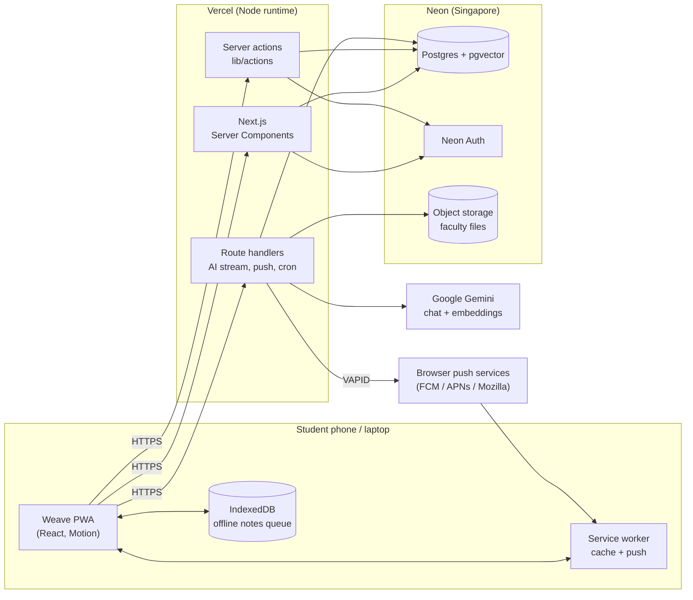

# Architecture

## 1. System overview

## 2. Layers
| Layer | Location | Responsibility |
|---|---|---|
| Presentation | `app/`, `components/` | Screens, motion, PWA chrome. Server Components fetch data; client components handle interaction |
| Actions | `lib/actions/` | Validate input (Zod), check session/role/scope, call domain modules, revalidate cache tags |
| Domain | `lib/progress/`, `lib/ai/`, `lib/push/` | Progress formula, RAG + prompts, push sending |
| Data | `lib/db/` | Drizzle schema, queries, migrations, seed |
| Auth | `lib/auth/` | Session lookup, `requireStudent()` / `requireFaculty()` guards |

## 3. Request flows

**Read (e.g. dashboard):** Server Component → `requireStudent()` → `lib/db/queries/dashboard.ts` (few aggregated queries) → cached per user with tag `user:<id>` → rendered HTML streamed with Suspense skeletons.

**Write (e.g. save note):** client editor (debounced) → server action `updateNote` → Zod → owner check → update `notes` + re-derive `note_links` → enqueue embedding → `revalidateTag('user:<id>')`.

**Offline write:** if offline, the edit goes to IndexedDB; the service worker / app replays it when back online (last-write-wins with `updated_at` check).

**AI tutor:** question → `/api/ai/tutor` → guard + daily limit → embed question → pgvector search over permitted chunks (own notes + own sections' material) → prompt with sources → streamed answer with citation IDs → saved to `ai_messages`.

**Push:** daily cron (`/api/cron/reminders`) finds due-soon assignments → `push_subscriptions` of target students → `web-push` → service worker shows notification → tap opens the assignment.

## 4. Key decisions
| Decision | Why |
|---|---|
| One Next.js app (no separate backend) | Simpler to build, deploy and explain; server actions give type-safe calls |
| Postgres + pgvector for both data and vectors | One database, permission filters in the same SQL as the vector search |
| Server-side progress calculation in `lib/progress` | One formula, consistent everywhere, testable |
| PWA instead of native app | One codebase for Android, iOS and desktop; no app store |
| Neon Singapore region | ~80 ms per query from India vs ~700 ms from US regions |
| Gemini via AI SDK | Free tier, good embeddings + vision; provider swappable in `lib/ai/config.ts` |

## 5. Deployment
- `main` → Vercel production; PR branches → preview deployments with a Neon branch per preview (later).
- Migrations run with the unpooled URL before deploy. Seed only on non-production branches.
- Cron jobs via Vercel cron (`vercel.ts`).
