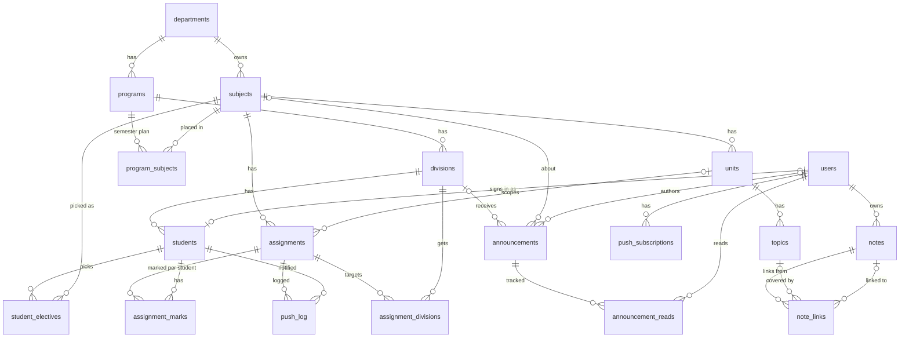

# Database schema (v1)

Postgres (Neon), managed with Drizzle ORM (`lib/db/schema/` is the source of truth). UUID primary keys; every table has `created_at` / `updated_at` (`timestamptz`).
Logins (email, password, sessions) live in Neon Auth's own `neon_auth` schema; our `users.id` = the Neon Auth user id.

## v1 tables (core app)

### College structure (`lib/db/schema/college.ts`)
| Table | Purpose | Key columns |
|---|---|---|
| `departments` | e.g. CSIT | `id`, `name` ("Computer Science and Information Technology"), `code` (unique, e.g. `"CSIT"`) |
| `programs` | CSIT, CY | `id`, `department_id` (→ `departments`, restrict), `name`, `code` (unique) |
| `divisions` | One class group per program per year, e.g. `"CSIT-2, admitted 2024"` | `id`, `program_id` (→ `programs`, restrict), `name` (`"CSIT-2"`), `admission_year` (≥ 2000), `current_semester` (check `3..8`) — unique `(program_id, name, admission_year)` |

### Syllabus (`lib/db/schema/syllabus.ts`)
| Table | Purpose | Key columns |
|---|---|---|
| `subjects` | Defined **once** per department, shared by programs | `id`, `department_id` (→ `departments`, restrict), `code`, `name`, `short_name` (e.g. `"CN"`, `"OS"`), `color_token` — unique `(department_id, code)` |
| `program_subjects` | A program's semester plan: which subject comes in which semester | `id`, `program_id` (→ `programs`, cascade), `subject_id` (→ `subjects`, restrict), `semester` (check `3..8`), `order` (≥ 1), `kind` enum (`core` / `departmental_elective` / `open_elective`), `elective_group` (nullable, e.g. `"CSIT-503"`; check null iff `core`) — unique `(program_id, subject_id)` |
| `units` | Units of a subject | `id`, `subject_id` (→ `subjects`, cascade), `title`, `order` (≥ 1) — unique `(subject_id, order)` |
| `topics` | Topics of a unit | `id`, `unit_id` (→ `units`, cascade), `title`, `order` (≥ 1) — unique `(unit_id, order)` |

**Theory subjects only** (user decision). Labs, projects, internships, audit courses and NSS/NCC are not in the app.
The CSIT list lives in `lib/db/seed/data/csit-subjects.json` (RGPV, semesters 3–8, 44 theory subjects). Drafted unit/topic trees live in `lib/db/seed/data/units-topics.json` (`"draft": true`).

**Electives:** every option of an elective group is its own subject row in `program_subjects` with the same `elective_group`.
A student sees the core subjects of the semester plus **only the option they picked** in each group (`student_electives`); until they pick, the group shows "Choose your elective".

This is how CY works: CSIT and CY point at the **same** subject rows (so units/topics are written once), CY can sit a shared
subject in a different `semester`, and CY's extra subjects simply have no CSIT row.

### People (`lib/db/schema/people.ts`)
| Table | Purpose | Key columns |
|---|---|---|
| `users` | Anyone who can log in | `id` (= Neon Auth user id), `email` (unique), `name`, `role` enum (`student` / `faculty` / `admin`), `image_url` (nullable) |
| `students` | The department's student list (CSV) — exists **before** the student signs in | `id`, `user_id` (nullable, unique → `users`, set null), `email` (unique), `full_name`, `enrollment_no` (unique — the only college ID we store), `division_id` (→ `divisions`, restrict), `phone` (nullable), `status` enum (`active` / `inactive`), `notify_deadline`, `notify_new_assignment`, `notify_status` (booleans, default `true`) |
| `student_electives` | The elective option a student picked per group | `id`, `student_id` (→ `students`, cascade), `program_id` (→ `programs`, restrict), `elective_group`, `subject_id` (→ `subjects`, restrict) — unique `(student_id, elective_group)` |

**Sign-in gate:** after Neon Auth signs someone in, the app looks up `students.email`. Found → link `user_id`, show onboarding.
Not found → sign out with "Ask your department to add you". This also limits the app to the college without relying on the email domain.

**Personal data we store:** name, college email, enrollment no., program/division/semester, chosen electives, optional phone and photo.
**Not stored:** address, parents' details, date of birth, Aadhaar or other ID numbers, category/caste, marks from university exams.

### Notes (`lib/db/schema/notes.ts`)
| Table | Purpose | Key columns |
|---|---|---|
| `notes` | Free student notes, private to the owner (no required topic) | `id`, `owner_id` (→ `users`, cascade), `title`, `content_md`, `search_vector` (generated `tsvector` over `title` + `content_md`), `word_count` (≥ 0) |
| `note_links` | Links a note to a syllabus topic or to another note | `id`, `note_id` (→ `notes`, cascade), `topic_id` (nullable → `topics`, restrict), `target_note_id` (nullable → `notes`, cascade) — check exactly one of `topic_id` / `target_note_id` is set, check `note_id <> target_note_id`, unique `(note_id, topic_id)` and unique `(note_id, target_note_id)` |

**Topic coverage rule:** a topic is "covered" when at least one of the student's notes links to it via `note_links.topic_id` (and in Phase 4, no quiz attempted or best quiz score ≥ 50%).

### Assignments (`lib/db/schema/assignments.ts`)
| Table | Purpose | Key columns |
|---|---|---|
| `assignments` | An offline paper assignment | `id`, `subject_id` (→ `subjects`, restrict), `unit_id` (nullable → `units`, set null), `title`, `description`, `due_at`, `max_marks` (nullable, check > 0), `created_by` (nullable → `users`, set null) |
| `assignment_divisions` | Which divisions get an assignment | `id`, `assignment_id` (→ `assignments`, cascade), `division_id` (→ `divisions`, cascade) — unique `(assignment_id, division_id)` |
| `assignment_marks` | Offline marking (no row = Pending) | `id`, `assignment_id` (→ `assignments`, cascade), `student_id` (→ `students`, cascade), `status` enum (`submitted` / `late` / `not_submitted`), `marks` (nullable, check ≥ 0), `remark` (nullable), `marked_by` (nullable → `users`, set null), `marked_at` — unique `(assignment_id, student_id)` |

### Announcements (`lib/db/schema/announcements.ts`)
| Table | Purpose | Key columns |
|---|---|---|
| `announcements` | Department / division / subject updates shown in the bell panel | `id`, `author_user_id` (nullable → `users`, set null), `division_id` (nullable → `divisions`, cascade), `subject_id` (nullable → `subjects`, set null), `kind` enum (`exam` / `material` / `class` / `assignment`), `title`, `body`, `file_key` (nullable), `created_at`, `updated_at` |
| `announcement_reads` | Per-user read receipts for announcements | `id`, `user_id` (→ `users`, cascade), `announcement_id` (→ `announcements`, cascade), `read_at` — unique `(user_id, announcement_id)` |

### Push (`lib/db/schema/push.ts`)
| Table | Purpose | Key columns |
|---|---|---|
| `push_subscriptions` | Web push endpoints per device | `id`, `user_id` (→ `users`, cascade), `endpoint` (unique), `p256dh`, `auth`, `user_agent` (nullable), `last_success_at` (nullable) |
| `push_log` | Stops duplicate deadline/status reminders | `id`, `assignment_id` (→ `assignments`, cascade), `student_id` (→ `students`, cascade), `kind` enum (`due_2d` / `due_today` / `new` / `status`), `sent_at` — unique `(assignment_id, student_id, kind)` |

**Not stored:** progress. It is calculated in `lib/progress/` from `note_links` / `notes` (and later quizzes), so it can never go stale.

## Relationships

## Rules
- Semesters a student can open: `3 .. division.current_semester`; later ones are shown locked.
- A student sees subjects from `program_subjects` of their own program only (core + picked electives), and assignments/announcements scoped to their own division and visible subjects only.
- Deleting a topic referenced by `note_links` is **blocked** (`onDelete: "restrict"`). Deleting a note cascades its `note_links`. Deleting a user cascades to their notes, announcement reads, and push subscriptions; the `students` row stays (`onDelete: "set null"`, since it is department data).

## Indexes
- `departments (code)` unique; `programs (code)` unique, `programs (department_id)`; `divisions (program_id, name, admission_year)` unique, `divisions (program_id)`
- `subjects (department_id, code)` unique, `subjects (department_id)`
- `program_subjects (program_id, subject_id)` unique, `program_subjects (program_id, semester)`
- `units (subject_id, order)` unique; `topics (unit_id, order)` unique
- `users (email)` unique; `students (email)` unique, `students (user_id)` unique, `students (enrollment_no)` unique, `students (division_id)`
- `student_electives (student_id, elective_group)` unique (covers `student_id` prefix lookups), `student_electives (subject_id)`
- `notes (owner_id, updated_at desc)`, GIN on `notes (search_vector)`
- `note_links (note_id, topic_id)` unique, `note_links (note_id, target_note_id)` unique, `note_links (topic_id)`, `note_links (target_note_id)`
- `assignments (subject_id, due_at)`, `assignment_divisions (assignment_id, division_id)` unique, `assignment_divisions (division_id)`, `assignment_marks (assignment_id, student_id)` unique, `assignment_marks (student_id)`
- `announcements (division_id, created_at desc)`, `announcements (subject_id, created_at desc)`, `announcements (created_at desc)`, `announcement_reads (user_id, announcement_id)` unique, `announcement_reads (announcement_id)`
- `push_subscriptions (endpoint)` unique, `push_subscriptions (user_id)`, `push_log (assignment_id, student_id, kind)` unique, `push_log (student_id)`

## Seed (`lib/db/seed/index.ts` — dev branch only, never production)
- Idempotent (deterministic UUIDs + upserts / `onConflictDoNothing`; safe to run multiple times without duplicating rows or clobbering an existing Neon Auth `students.user_id`).
- Refuses to run when `NODE_ENV=production`, `VERCEL_ENV=production`, `NEON_BRANCH=production`, or the DB URL looks like a production branch.
- 1 department (`CSIT`), 2 programs (`CSIT`, `CY`), 9 divisions (`CSIT-1`, `CSIT-2`, `CY` across 2nd year sem 3, 3rd year sem 5, and 4th year sem 7).
- All 44 theory subjects from `lib/db/seed/data/csit-subjects.json` mapped to both CSIT and CY (until the CY syllabus arrives), with 5 drafted RGPV units × 5 topics each from `lib/db/seed/data/units-topics.json` (`"draft": true`).
- 30 students per division (270 total) with realistic Indian names, RGPV-style enrollment numbers (e.g. `0827CI231001`), and `firstname.lastname@college.ac.in` emails; electives picked across all open semesters.
- Primary demo student **Aarav Sharma** in `CSIT-2` (sem 5, `0827CI241031`): uses `process.env.DEMO_STUDENT_EMAIL` when set (otherwise `aarav.sharma@college.ac.in`). Never hardcodes a real email.
- CSIT-2 sem 5 demo content: 6 assignments (3 upcoming within 7 days, 3 past with mixed `submitted`/`late`/`not_submitted` marks), 4 announcements (CN class test moved to Friday, Unit 3 slides uploaded, No lectures on Monday, Assignment 3 posted; 2 unread), and 5 notes for Aarav Sharma (including `"Round Robin vs priority"`) with topic links and a note-to-note link.

## Later tables (added in their phase, not in v1)
- **Phase 3 (faculty):** `faculty_teaching` (faculty, subject, division), `resources` (uploaded files in the `materials` bucket).
- **Phase 4 (extras):** `resource_chunks` + `note_chunks` (pgvector embeddings), `quizzes`, `quiz_attempts`, `ai_conversations`, `ai_messages`, `ai_usage`.
