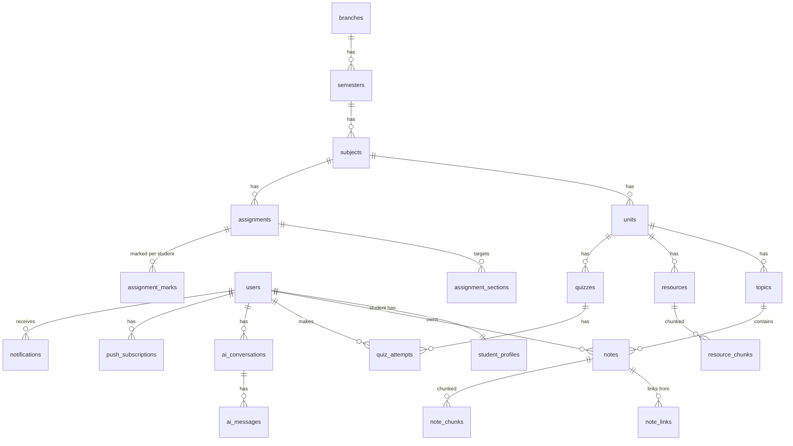

# Database schema (draft v0)

Postgres (Neon) + pgvector, managed with Drizzle. UUID primary keys; every table has `created_at` / `updated_at`.
This is the planned design — the Drizzle schema in `lib/db/schema/` is the source of truth once it exists.

## Tables

| Table | Purpose | Key columns |
|---|---|---|
| `users` | App user (id = Neon Auth user id) | id, name, email, role (`student`/`faculty`/`admin`), image |
| `student_profiles` | Academic info | user_id (PK, FK), branch_id, current_semester, section |
| `branches` | e.g. CSE | id, name, code |
| `semesters` | 1–8 per branch | id, branch_id, number, starts_on, ends_on |
| `subjects` | Subjects in a semester | id, semester_id, name, code, order, color_token |
| `subject_prerequisites` | Prerequisite edges | subject_id, prerequisite_subject_id |
| `units` | Units in a subject | id, subject_id, title, order |
| `topics` | Topics in a unit | id, unit_id, title, order |
| `faculty_teaching` | Who teaches what (Phase 4) | faculty_id, subject_id, section |
| `resources` | Faculty uploads | id, unit_id, uploaded_by, file_key, file_name, mime, pages, visible_sections[] |
| `resource_chunks` | RAG chunks of uploads | id, resource_id, content, page_or_slide, embedding vector(768) |
| `notes` | Student notes | id, owner_id, topic_id, title, content_md, content_json, search_vector (generated), word_count |
| `note_chunks` | RAG chunks of notes | id, note_id, content, embedding vector(768) |
| `note_links` | Links by ID | id, from_note_id, to_type (`note`/`topic`/`unit`), to_id |
| `assignments` | Assignments | id, subject_id, unit_id?, title, description, due_at, created_by |
| `assignment_sections` | Target sections | assignment_id, section |
| `assignment_marks` | Offline marking (no row = pending) | assignment_id, student_id, status (`submitted`/`late`/`not_submitted`), marks?, remark?, marked_by, marked_at |
| `quizzes` | Generated quizzes (cached) | id, unit_id, topic_id?, questions_json, source_hash |
| `quiz_attempts` | Attempts | id, quiz_id, student_id, score, answers_json, attempted_at |
| `ai_conversations` | Tutor chats | id, student_id, scope_type, scope_id |
| `ai_messages` | Messages + citations | id, conversation_id, role, content, citations_json |
| `ai_usage` | Daily AI quota per student | student_id, day, requests, tokens |
| `note_analyses` | Cached Analyze Note | note_id, content_hash, summary, tags[], todos[], suggested_links_json |
| `activity_log` | One row per study action | id, student_id, type, ref_id, created_at |
| `notifications` | In-app notifications | id, user_id, type, title, body, href, read_at |
| `push_subscriptions` | Web push endpoints | id, user_id, endpoint (unique), p256dh, auth, user_agent, last_success_at |
| `notification_prefs` | Per-user toggles | user_id, deadline, new_assignment, status_marked |

`activity_log.type`: `note_created`, `note_updated`, `quiz_attempted`, `ai_question`, `resource_opened`.

## Relationships

## Indexes (plan)
- `notes (owner_id, topic_id)`, `notes (owner_id, updated_at desc)`, GIN on `notes.search_vector`
- HNSW on `resource_chunks.embedding` and `note_chunks.embedding` (cosine)
- `assignment_sections (section)`, `assignments (subject_id, due_at)`, `assignment_marks (student_id)`
- `quiz_attempts (student_id, quiz_id)`, `activity_log (student_id, created_at)`, `notifications (user_id, read_at)`

## Delete rules
- Deleting a topic with notes is **blocked** (faculty must move or archive it). Deleting a user cascades to their private data.
