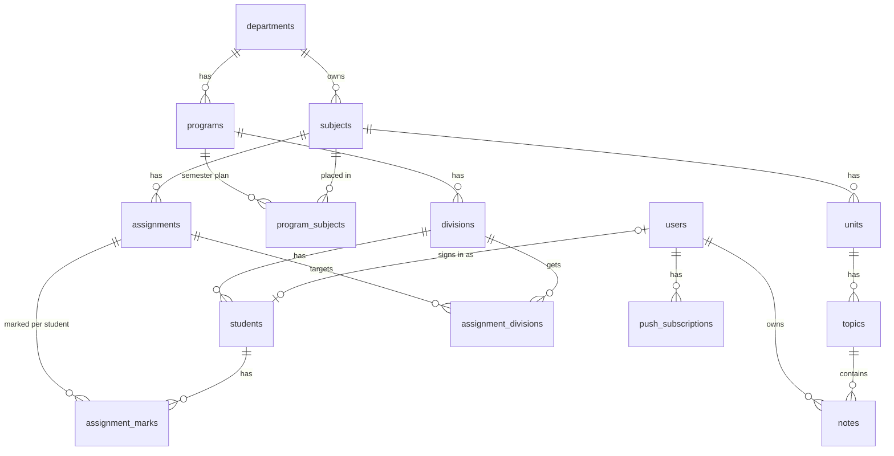

# Database schema (v1 plan)

Postgres (Neon), managed with Drizzle. UUID primary keys; every table has `created_at` / `updated_at`.
This is the planned design — the Drizzle schema in `lib/db/schema/` is the source of truth once it exists.
Logins (email, password, sessions) live in Neon Auth's own `neon_auth` schema; our `users.id` = the Neon Auth user id.

## v1 tables (core app)

### College structure
| Table | Purpose | Key columns |
|---|---|---|
| `departments` | e.g. CSIT | id, name ("Computer Science and Information Technology"), code ("CSIT") |
| `programs` | CSIT, CY | id, department_id, name, code |
| `divisions` | One class group per program per year, e.g. "CSIT-2, admitted 2024" | id, program_id, name ("CSIT-2"), admission_year, current_semester (3–8) |

### Syllabus
| Table | Purpose | Key columns |
|---|---|---|
| `subjects` | Defined **once** per department, shared by programs | id, department_id, code, name, color_token |
| `program_subjects` | A program's semester plan: which subject comes in which semester | program_id, subject_id, semester (3–8), order — unique (program_id, subject_id) |
| `units` | Units of a subject | id, subject_id, title, order |
| `topics` | Topics of a unit | id, unit_id, title, order |

This is how CY works: CSIT and CY point at the **same** subject rows (so units/topics are written once), CY can sit a shared
subject in a different `semester`, and CY's extra subjects simply have no CSIT row.

### People
| Table | Purpose | Key columns |
|---|---|---|
| `users` | Anyone who can log in | id (= Neon Auth user id), email (unique), name, role (`student` / `faculty` / `admin`), image_url |
| `students` | The department's student list (CSV) — exists **before** the student signs in | id, user_id (nullable, unique → users; filled on first sign-in), email (unique), full_name, enrollment_no (unique), roll_no, division_id, lab_batch (nullable), phone (nullable), status (`active` / `inactive`), notify_deadline, notify_new_assignment, notify_status (booleans, default true) |

**Sign-in gate:** after Neon Auth signs someone in, the app looks up `students.email`. Found → link `user_id`, show onboarding.
Not found → sign out with "Ask your department to add you". This also limits the app to the college without relying on the email domain.

**Personal data we store:** name, college email, enrollment no., roll no., program/division/semester, lab batch, optional phone and photo.
**Not stored:** address, parents' details, date of birth, Aadhaar or other ID numbers, category/caste, marks from university exams.

### Notes
| Table | Purpose | Key columns |
|---|---|---|
| `notes` | Student notes, private to the owner | id, owner_id (→ users), topic_id, title, content_md, search_vector (generated tsvector), word_count |

### Assignments
| Table | Purpose | Key columns |
|---|---|---|
| `assignments` | An assignment | id, subject_id, unit_id (nullable), title, description, due_at, max_marks (nullable), created_by (nullable → users; null while seeded/imported) |
| `assignment_divisions` | Which divisions get it | assignment_id, division_id |
| `assignment_marks` | Offline marking (no row = Pending) | assignment_id, student_id (→ students), status (`submitted` / `late` / `not_submitted`), marks, remark, marked_by, marked_at |

### Push
| Table | Purpose | Key columns |
|---|---|---|
| `push_subscriptions` | Web push endpoints per device | id, user_id, endpoint (unique), p256dh, auth, user_agent, last_success_at |
| `push_log` | Stops duplicate reminders | assignment_id, student_id, kind (`due_2d` / `due_today` / `new` / `status`), sent_at — unique (assignment_id, student_id, kind) |

**Not stored:** progress. It is calculated in `lib/progress/` from notes (and later quizzes), so it can never go stale.

## Relationships

## Rules
- Semesters a student can open: 3 … `division.current_semester`; later ones are shown locked.
- A student sees subjects from `program_subjects` of their own program only, and assignments of their own division only.
- Deleting a topic with notes is **blocked**. Deleting a user cascades to their notes and push subscriptions; the `students` row stays (it is department data).

## Indexes (plan)
- `notes (owner_id, topic_id)`, `notes (owner_id, updated_at desc)`, GIN on `notes.search_vector`
- `program_subjects (program_id, semester)`, `units (subject_id, order)`, `topics (unit_id, order)`
- `students (division_id)`, `students (email)` unique, `students (user_id)` unique
- `assignment_divisions (division_id)`, `assignments (subject_id, due_at)`, `assignment_marks (student_id)`

## Seed (dev branch only, never production)
- 1 department (CSIT), programs CSIT + CY, divisions CSIT-1 / CSIT-2 / CY for 2nd, 3rd and 4th year.
- Syllabus for semesters 3–8 with a realistic **placeholder** until the department's real syllabus CSV arrives; CY gets its extra subjects and a few shifted semesters.
- ~30 students per division (fake names, emails, enrollment numbers), most without a login.
- 2–3 demo accounts that can log in (a strong and a weak student) for testing and the viva.
- ~60 days of notes and assignment marks with a realistic mix of strong / average / behind students. Deterministic (fixed random seed).
- The seed script refuses to run when `DATABASE_URL` points at the production branch.

## Later tables (added in their phase, not in v1)
- **Phase 3 (faculty):** `faculty_teaching` (faculty, subject, division), `resources` (uploaded files in the `materials` bucket).
- **Phase 4 (extras):** `resource_chunks` + `note_chunks` (pgvector embeddings), `quizzes`, `quiz_attempts`, `ai_conversations`, `ai_messages`, `ai_usage`.
